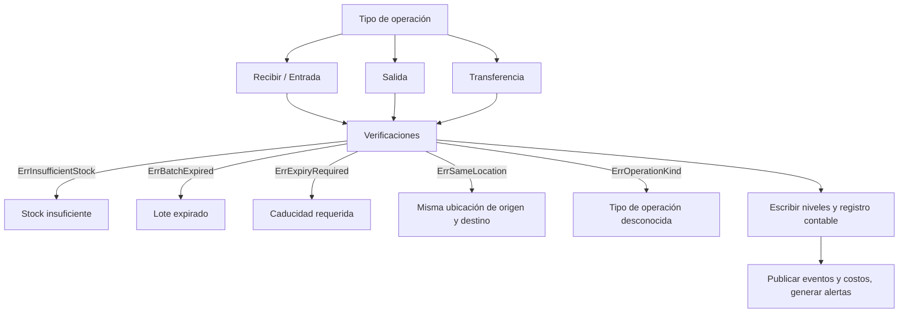

# Operación de Stock

Contexto: Flujo invocado para el control de inventario y verificado por `tests/rules_test.go`, `tests/output_test.go`, `tests/stock_test.go`.

1. **Determinación del Tipo**: Evalúa si es entrada, salida o traslado.
2. **Validaciones**: Confirma invariantes del negocio previas al movimiento.
3. **Escritura**: Modifica o crea niveles de stock y registra movimientos de manera segura.
4. **Disparadores Secundarios**: Genera la observabilidad posterior al evento (alertas de stock bajo, eventos de sistema, costos).
